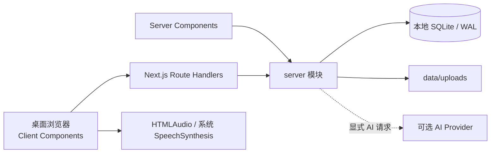

# IELTS Studio 架构

记录日期：2026-10-05。面向 Windows、本地单用户、IELTS Academic。日常启动见 [README_LOCAL.md](../README_LOCAL.md)。沿用 ISTS 的 Study Loop、Study Task、Practice Attempt、Learning Signal、Review Item、Source Material 等领域定义，详见 [CONTEXT.md](../CONTEXT.md)。

## 1. 运行边界

- Next.js 16.2 / React 19 / TypeScript，使用 App Router 和 Route Handlers。浏览器负责交互、选词、音频与计时；服务器负责 SQLite、导入、文件访问、AI 和备份。
- `better-sqlite3` 为唯一核心持久层；没有数据库服务、Docker、Supabase、Redis 或账号前置要求。
- 开发与生产启动默认绑定 `127.0.0.1`。HTTP 写入拒绝跨源请求；保留上游可选 Basic Auth，不要求个人本地用户登录。
- `src/lib/product.ts` 集中产品名称。CSS 使用主题变量，中文操作界面，英文学习材料。
- npm 脚本调用项目内依赖；构建不下载 Google Fonts，字体使用本地系统回退。

## 2. 数据模型

所有运行时建表使用 `CREATE TABLE IF NOT EXISTS` 或增量加列。首次示例数据通过 `studio_migrations` 标记，后续启动不重复覆盖用户记录。示例只包含原创短文、听力稿及少量词汇。

| 学习对象 | 主要表 | 说明 |
|---|---|---|
| 今日计划与偏好 | `settings`, `studio_preferences`, `study_tasks` | 学习时长、目标分、主题与当天可勾选任务 |
| 实际学习时间 | `study_sessions` | 可见学习页面的活动 heartbeat；任务预计时长不冒充实际时长 |
| 资料 | `source_materials`, `material_metadata` | 原文、文件、来源、标签、难度、Section、备注、使用权说明 |
| 练习 | `practice_sets`, `practice_attempts` | 题目 JSON、来源文本快照、参考答案、资源与篇章 JSON、作答与成绩 |
| 阅读工作台 | `practice_drafts`, `practice_annotations` | 答案草稿、字号、计时、笔记、选区高亮/下划线 |
| 错误原因 | `practice_mistake_reasons` | `attempt_id + question_id` 唯一，保存错题分类 |
| 听写 | `dictation_attempts` | 参考文本、输入、AB 时间范围、结构化词级错误 |
| 词汇 | `vocabulary_words`, `vocabulary_metadata` | 核心词条、来源句、lemma、IPA、词族、搭配等 |
| 复习 | `vocabulary_reviews`, `vocabulary_review_details`, `vocabulary_scheduler_state` | 评分历史、四种模式、实际回答和 FSRS 状态 |
| 写作 | `writing_drafts`, `writing_submissions`, `writing_feedback_details` | 版本组、草稿、图片、计时、结构化反馈和被评估的原文 |
| 统一错题 | `review_items` | 来源、类别、错误次数、复习/掌握状态与日期 |
| AI / 模考 | `coach_messages`, `mock_exams` | 助教对话、上游模拟考试记录 |

SQLite 默认位置为 `data/ists.db`，通过 `DATABASE_URL` 可更改。上传文件默认 `data/uploads/`，通过 `UPLOAD_DIR` 可更改。数据、环境文件、日志、`.next` 和秘密配置均不提交 Git。UTC 时间写入记录；按 `APP_TIME_ZONE`（默认 `Asia/Shanghai`）计算学习日。

## 3. 材料流水线

1. 粘贴文本或选择本地文件，创建带来源信息的 Source Material。
2. TXT/Markdown 读取 UTF-8；HTML 转纯文本，移除脚本和样式；PDF 通过 `pdf-parse`，DOCX 通过 `mammoth` 提取文本。扫描 PDF 不含文本层时用户可补贴文本，OCR 不属于 P0。
3. 单个上传文件限 25 MB，使用随机文件名保存。文档提取失败不会先遗留一个成功的资料记录；数据库插入失败会清理刚写入的附件。
4. 音频直接在本地保存，MP3/WAV/M4A 根据扩展名修正 MIME。`/api/uploads/[id]` 支持 Range、206 和 416，以支持浏览器 seek。HTML/SVG/XML 等潜在活动内容按 attachment 返回，并限制脚本执行。
5. Materials 详情可以修改文本 / Transcript 和 metadata。Mode A 创建稳定的无题自由学习集；Mode C 通过 Zod 校验用户手动题目，创建带原文快照的新练习；Mode B 为可选 AI 生成。

有题练习保持原文与题目的历史快照，后续修改资料不更改旧评分依据。无题学习集可读取修正后的 Transcript。

经过核对的官方、个人题库使用离线 pack 导入器，调用应用的题目和资源验证器，
验证原件哈希并在事务前备份。清单的可选 `readingPassages.documents` 用
`documentIndex` 引用同套 `documents` 数组；导入后转换为实际 `/api/uploads/ID`，
支持同篇原文与题本来自不同 PDF。原卷、题干、答案和私人映射不进入代码仓库。

已安装题库补分篇使用 `scripts/backfill-reading-passages.cjs`。私人映射记录现存
`questions_json` 的 SHA-256、原文件哈希、已核对的总页数、页范围和原题 ID。
脚本提供只读 dry-run，正式执行先建 SQLite 一致性备份，再事务更新
`resource_json`；不重建题目、附件、草稿或 Attempt。相同映射重复执行无更新，
哈希不匹配或已有分篇发生冲突则拒绝覆盖。

## 4. 阅读与听力

`src/lib/question-types.ts` 是题型描述与输入校验的单一来源。14 个题型共用 text、choice、matching 三种答案控件；表格、摘要、地图的每个空格对应一个独立问题，便于客观评分及按题型聚合。图示题可以引用资料库中的本地图片。

Reading 在桌面宽屏约 2:1 分栏，左右各一个纵向滚动区域，窄屏上下排列。
顶部选择 Passage；左侧保留原 PDF 排版，连续展示本篇材料与题目，右侧根据
原题 ID 只显示本篇答题框和导航。单篇专项没有多篇切换栏，原创文本练习继续
使用文本渲染、字号和选区标记。两种材料均支持 Notes、全屏与计时。

`resource_json` 保留来源、质量说明、原文件及可选
`readingPassages: [{id, label, documents, questionIds}]`。其中 `documents` 复用
`OfficialDocument`，但 `page` 与 `endPage` 必填；一篇可关联多个本地 PDF 范围。
资源校验拒绝非法范围、未关联的题目文件与包含答案的范围。Practice Set 层校验
引用题目存在、每题恰好分配一次、联合覆盖全套题目、同一乱序组不跨篇。
旧资源不含此字段仍可读取，不能凭固定题数猜测分篇。

切篇只过滤显示，不裁减 `draft.answers`、题目数组或评分输入。草稿及注释自动
写入 SQLite，`POST /api/practice/attempts` 始终提交整卷答案和累计用时。当前篇
题号导航与 N/P 使用原题的全卷索引，避免显示过滤后的重新编号。提交失败保留
当前答案；重新练习保留历史 Practice Attempt；错误原因单独保存。

每篇左右滚动位置与所选题号只存于当前组件会话的内存，切回时恢复，PDF 的
等比例占位完成后再次恢复左侧位置。刷新从第一篇开始，但恢复 SQLite 中已保存
的整卷答案、笔记和计时；阅读位置不作为长期学习记录。答案需显式展开，完整
原文件入口仍允许用户查看含附录的整份 PDF。

### PDF 连续预览

`GET /api/uploads/[id]/preview?metadata=1` 返回 `{total, pages:[{page,width,height}]}`，
仅提供页数和尺寸。原有 `?page=N` 返回 `{image,text,page,total,width,height}`，
保留原接口字段，新增图片尺寸供占位和校验使用；均使用本地 `pdf-parse` worker，
不依赖 CDN。客户端只展开已核对的篇章页范围，重复物理页按 URL 与页号去重。

客户端给所有页保留等比例占位，仅挂载可见页及前后两页的图片，最多同时请求
两页，离开窗口或切篇时取消旧请求。图片与提取文字缓存有数量和内存上限，
远处图片卸载后占位不缩短，失败页可独立重试。缩放保持当前可见页附近的位置。
服务端按文件路径、大小及修改时间等身份缓存，合并同页在途请求；预览 LRU
上限为 20 页 / 64 MiB，metadata 为 64 个文件 / 4 MiB。响应使用
`Cache-Control: private, no-cache`，恢复后的新附件路径不复用旧服务端预览。

Evidence 为题目提供的逐字原文片段，点击 Find Evidence 定位并高亮。没有证据时明确说明，不从答案字符串猜造依据。内置原创练习的 Evidence 通过测试确认出现在原文中；Not Given 的证据是相关上下文，仍应结合解析理解信息缺失。

Listening 使用原生 HTMLAudio，支持播放/暂停、±5/±10 秒、0.75/0.9/1/1.1/1.25 倍速，以及 A/B 秒数或当前播放位置设置循环。无音频原创示例可使用 en-GB 系统 TTS；TTS 依赖系统已安装语音，精确 seek 和 AB 循环用于真实音频。

Dictation 通过单词级编辑距离对齐，分类为 missing、extra、wrong、spelling。拼写标签是字符相似度启发式，不冒充语义诊断。一次最多 500 个词，防止长文本产生无界矩阵开销。错误记录与 Review Item 在同一事务内保存。

## 5. Vocabulary 与 SRS

全局 `VocabularyCapture` 在明确选中英文时显示 Add to Vocabulary，并保留来源句和材料标题。新词可暂时没有释义；不会生成假的字典解释。释义、IPA、collocations、synonyms、antonyms、word family、tags 和 notes 均可本地编辑。

四种复习模式为 Recognition、Recall、Spelling 和 Context。单词与句子使用浏览器 SpeechSynthesis，默认英式；发音不需要 AI Key，但是否有本地声音由 Windows/浏览器决定。

`VocabularyScheduler` 隔离调度算法，新增复习使用 `ts-fsrs`，Again / Hard / Good / Easy。已有到期时间在启动时不被重置：首次 FSRS 复习通过真实历史评分回放迁移，之后加载保存的 FSRS 状态。参数为目标 retention 0.9、关闭 fuzz，未声称个性化训练模型。上游 SM-2 工具为兼容旧调用保留。详见 [ADR 0004](adr/0004-vocabulary-fsrs.md)。

## 6. Writing 学习闭环

Academic Task 1 的七类图示与 Task 2 的五类论证题共享草稿编辑器。保存 prompt、图片、essay、字数、计时和用户设置的时限。Draft 1/2/3 通过同一 `group_id` 关联，重写创建新版本，旧版本保留，可对照正文与历史反馈。

写作先保存草稿，再调用可选 AI。只有通过结构校验且来自实际 Provider 的反馈才展示 AI Estimated Band；离线或 Provider 失败时显示“未评分”，仍可完成写作并保留全文。四项标准、句级语法/词汇问题、较好表达、rewrite、action items 与分类错误写入本地，供 Mistakes 与 Analytics 使用。

## 7. AI Provider 与数据边界

`src/server/ai.ts` 保留统一 Provider 适配和顺序 fallback，支持 Responses API / Chat Completions。Settings 可配置 Base URL、API Key、Model 和 protocol；远程地址要求 HTTPS，本机模型服务允许 HTTP。

本地设置位于数据库目录旁的 `ai-provider.secret.json`，不在 SQLite、普通 JSON 备份或浏览器 bundle 中。Settings 只返回是否已配置 key，空 key 输入用于保留已保存的 key。环境变量配置仍可使用。Codex fallback 保留但须在偏好中启用，避免无意读取并使用现有凭据。

基础 Reading / Listening / Vocabulary / SRS / Writing editor / Materials / Mistakes / Analytics / Backup 不调用 AI。Tutor 上下文只发送有限的相关摘录和近期学习信息；用户触发 AI 请求时，所需的学习内容会发送给配置的 Provider。

## 8. 备份与恢复

完整 JSON 包含 `format: ielts-studio`、`version: 1`、导出时间、全部 SQLite 应用表和 base64 附件。导出先初始化各领域表，避免尚未打开的模块被遗漏。API key 和环境文件不在数据库中，不随完整学习备份导出。

恢复前检查格式、版本、全部表与字段、JSON 列、附件对应关系、总大小及路径；附件路径在导出中转为 `upload:ID`，恢复到新的随机本地文件名，不相信备份中的任意路径。附件合计上限 256 MB，大型库建议关闭服务器后复制整个 data 目录。

练习资源及可选篇章范围随 `resource_json` 一并导出。恢复时对篇章执行相同的
题目引用、完整覆盖和题组校验，并遍历 `readingPassages[].documents` 的本地
附件引用；缺失文件、未关联题目 PDF 或含答案的默认范围会拒绝恢复。

恢复前自动保存当前完整安全快照；恢复数据使用 SQLite 事务，并在提交前检查外键。失败时回滚原数据库并移除本次创建的附件。旧附件保留以便恢复，不主动删除用户源文件。

另可下载 SQLite 数据库快照；数据库单文件不包含附件，需与 uploads 一起保存。升级执行 npm/build/Git 操作不应清空 data；任何未来破坏性迁移都应有独立迁移记录与可恢复备份。

## 9. Analytics 与验证

Analytics 仅聚合本地真实 Attempt、Review、Draft/Feedback、Dictation 与 Study Session。无数据展示空状态，短题不按比例冒充 IELTS Band；40 题完整 Reading / Listening 才使用独立转换 utility。写作仅使用真实 AI 结构化反馈产生趋势。每题平均耗时来自总耗时除以题数，不是逐题精确追踪。

核心验证为 Vitest 单元/SQLite持久化测试、TypeScript、ESLint 和生产 build；另有 localhost API 和真实浏览器流程验证。完整交付结果由 [IMPLEMENTATION_LOG.md](../IMPLEMENTATION_LOG.md) 记录。
